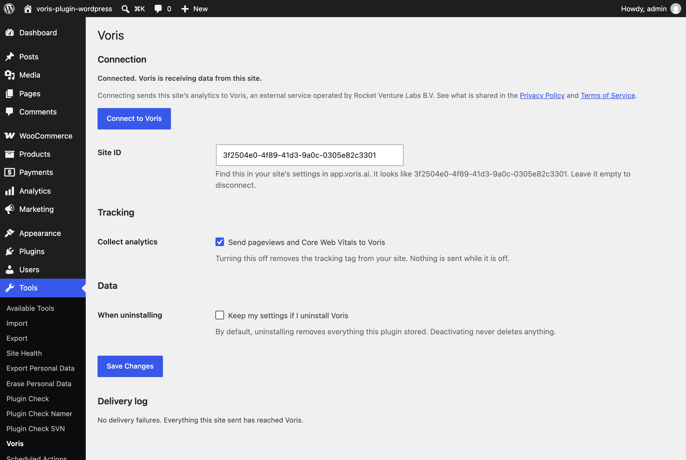
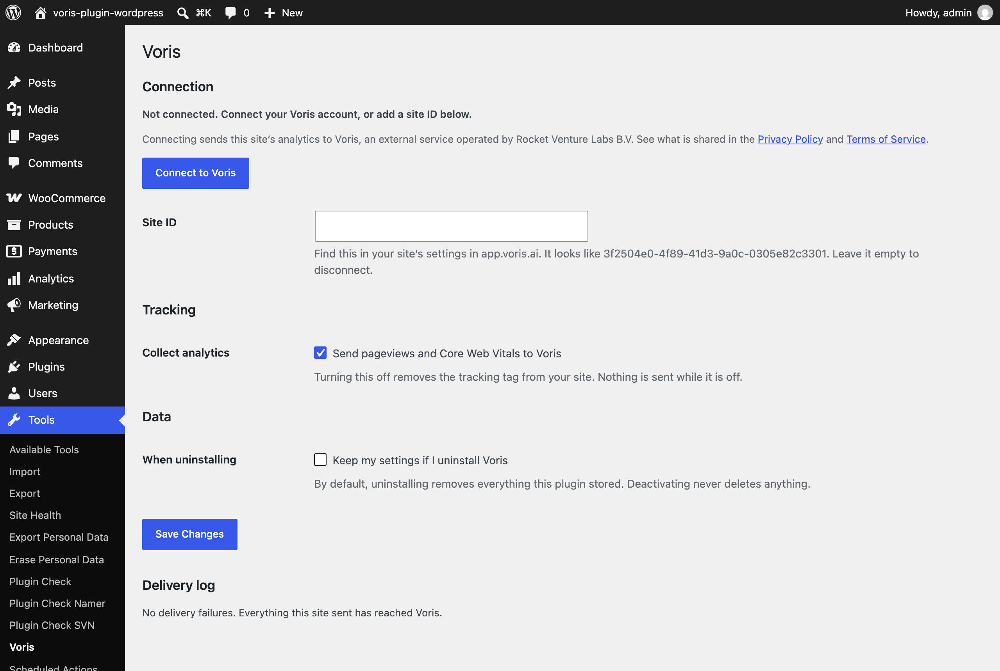

# Voris - Privacy-first Analytics

For WordPress & WooCommerce.

Privacy-first analytics for WordPress and WooCommerce. Connect to [Voris](https://voris.ai) in one click — **no code, no cookie banner.**

This plugin connects your WordPress site to Voris without editing a theme, pasting a snippet into a code-snippets plugin, or losing your setup on the next theme update.

Voris is a brand of **Rocket Venture Labs B.V.** (Amsterdam, the Netherlands). Rocket Venture Labs develops this plugin and operates the Voris service at [voris.ai](https://voris.ai).

---

## What it does

- **Connects in one click.** "Connect to Voris" opens Voris's approval page; the plugin binds this site and stores the connection for you — no copy-pasting IDs. You can still enter a site ID by hand if you prefer.
- **Counts visits.** Every public page reports pageviews and Core Web Vitals to Voris, exactly as Voris's standard install does.
- **Reports store revenue.** With WooCommerce active, a completed order reports the order total and currency **from your server** — so revenue is counted even behind ad-blockers, page caches, or off-site payment gateways. Refunds are reported as matching corrections.
- **Keeps you ahead of your plan.** The settings screen shows your usage against your plan, with a nudge as you approach the limit. Figures come from Voris; no payment or checkout happens in WordPress.
- **Stays out of the way.** If Voris is slow or unreachable, your pages, admin, and checkout carry on exactly as if the plugin were not installed. Failed deliveries retry in the background and, if they still can't be sent, are listed for you on the settings screen.

## Privacy

Voris is **cookieless by default** (Mode A): no cookies, no browser storage, and **no visitor, session, or user identifier**. No cookie banner is required in Mode A.

**What the plugin never sends:** no visitor IP address; no names, email addresses, or postal addresses (not even from an order); no visitor/session/user identifiers. Voris derives geography and device from the request on its own side and **discards the IP** — it is never stored.

### Works with your consent plugin

Voris registers with the **WP Consent API**, which most consent managers support (CookieYes, Complianz, Cookiebot, Borlabs Cookie, Real Cookie Banner, and others). When one is active and set to require statistics consent, Voris's tracking tag **waits for that consent** before it loads. With no consent plugin present, Mode A needs no banner and the tag loads as usual. The settings screen tells you which state you're in.

### External service

This plugin is a client for **Voris**, a service operated by **Rocket Venture Labs B.V.** (Amsterdam, the Netherlands). It contacts Voris in three ways:

| Purpose | Endpoint | Sends |
|---|---|---|
| Browser analytics tag (deferred) | `https://cdn.voris.ai/v1/vor.js` | pageviews + Core Web Vitals |
| Server-side commerce events | `https://ingest.voris.ai/api/event` | order/refund total + currency + item count (no PII, no IP, no identifiers) |
| Connect + plan usage | `https://app.voris.ai` (`/oauth/*`, `/api/partner`) | one-click OAuth connect + plan reads |

Nothing is sent to Voris until you connect. By connecting you agree to the [Terms of Service](https://voris.ai/legal/terms/) and [Privacy Policy](https://voris.ai/legal/privacy/).

## Requirements

- WordPress **6.6+** (tested up to **7.1**)
- PHP **8.1+**
- WooCommerce is optional — commerce features appear only when it's active, and nothing errors without it.

## Installation

Once the listing is live, install from the **WordPress.org plugin directory** (submission in progress).

To install from source in the meantime:

1. Download **voris.zip** from the [latest release](https://github.com/Rocket-Venture-Labs/voris/releases/latest) and upload it under **Plugins → Add New → Upload Plugin**, or copy this repository into `wp-content/plugins/voris-privacy-first-analytics/`.
2. Activate **Voris - Privacy-first Analytics** under **Plugins**.
3. Go to **Tools → Voris**, click **Connect to Voris** and approve — or paste your site ID (it looks like `3f2504e0-4f89-41d3-9a0c-0305e82c3301`).
4. Save. Tracking starts immediately.

### Upgrading from 1.0.0

Version 1.1.0 renamed the plugin to **Voris - Privacy-first Analytics**, and it now installs in a `voris-privacy-first-analytics/` folder instead of `voris/`. Your settings carry over. If you installed 1.0.0:

1. Deactivate the old **Voris** plugin first. The two copies cannot be active at the same time.
2. Install and activate 1.1.0 as above.
3. Remove the old copy by deleting its `voris/` folder. If you would rather delete it from the Plugins screen, first tick **Keep my settings if I uninstall Voris** on Tools → Voris, because the old copy's uninstall would otherwise clear the settings the new one uses.

## Screenshots

**Settings — everything on one screen:** connect, see it's live, control tracking and uninstall behaviour, and read exactly what's shared with Voris.

**One-click connect:**

## Links

- Website: **https://voris.ai**
- Documentation: **https://docs.voris.ai**
- [Terms of Service](https://voris.ai/legal/terms/) · [Privacy Policy](https://voris.ai/legal/privacy/)

## Contributing & issues

Bug reports and feature requests are welcome — please [open an issue](https://github.com/Rocket-Venture-Labs/voris/issues).

> This repository is the **public distribution mirror** of the Voris WordPress plugin (the code that ships to WordPress.org). It carries released, shipping code only; day-to-day development happens in a separate repository.

## License

[GPL-2.0-or-later](LICENSE). See [`CHANGELOG.md`](CHANGELOG.md) for release history and [`readme.txt`](readme.txt) for the WordPress.org listing.
